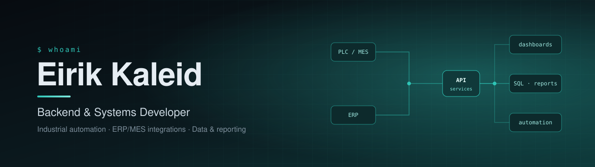

<div align="center">




<br/>

<a href="https://www.linkedin.com/in/berkesezen/"></a>
<a href="mailto:eirikaleid@gmail.com"></a>


</div>

<br/>

## About

Mechanical engineer turned backend developer. I build **enterprise software for industrial environments** — the systems that sit between the shop floor and the office: production tracking, ERP/MES integrations, maintenance and warehouse tooling, and the reporting layer on top.

```yaml
focus:      [backend services, industrial automation, internal tooling]
strengths:  [relational schema design, high-performance reporting, system integration]
principles: [type-safe, observable, maintainable — reliable over clever]
learning:   Go — for high-performance backend services
```

## What I Work On

| | |
|:--|:--|
| 🏭 **Industrial systems** | Production tracking, ERP/MES integrations and shop-floor tooling used every day |
| 🗄️ **Data layer** | Schema architecture through to fast, accurate reporting on MySQL, PostgreSQL and SQL Server |
| ⚙️ **Automation** | Backend services and workflows that connect disparate systems and remove manual steps |
| 🧮 **Engineering tools** | Software grounded in mechanical engineering — CAD, machining, vehicle dynamics |

## Featured Projects

<table>
<tr>
<td width="50%" valign="top">

### [ADEM CAD](https://github.com/eirikaleid/adem-cad)
Browser-native parametric CAD — sketch, extrude, boolean, export to STEP. Real B-Rep kernel (OpenCascade.js / WASM) with a Three.js WebGPU viewport.


</td>
<td width="50%" valign="top">

### [CNC Analyzer Pro](https://github.com/eirikaleid/CNC-Analyzer-Pro)
Real-time parameter analysis and risk assessment for woodworking CNC routers — chipload, mechanical and thermal risk, a 0–100 safety score and corrective targets.


</td>
</tr>
<tr>
<td width="50%" valign="top">

### [outreach-pilot](https://github.com/eirikaleid/outreach-pilot)
Scrapes local businesses from Google Maps, scores each prospect with two AI agents and sends personalized outreach through Gmail — one command, end to end.


</td>
<td width="50%" valign="top">

### [ScrapeLens](https://github.com/eirikaleid/ScrapeLens)
Monorepo of two independent scraping microservices — Hacker News intelligence and YouTube trends — each with a clean REST API and its own dashboard.


</td>
</tr>
<tr>
<td width="50%" valign="top">

### [VoxBridge](https://github.com/eirikaleid/VoxBridge)
Live voice translation: speak Turkish, get instant English subtitles and speech — fully local with Whisper, routable into Discord, Zoom or Teams.


</td>
<td width="50%" valign="top">

### [gma-game](https://github.com/eirikaleid/gma-game)
90-second, 8-player real-time web arena game — authoritative WebSocket server with client-side prediction, tested under simulated latency and packet loss.


</td>
</tr>
</table>

## Tech Stack

<table>
<tr><td><b>Languages</b></td><td></td></tr>
<tr><td><b>Backend</b></td><td>&nbsp;<a href="https://orm.drizzle.team/"></a></td></tr>
<tr><td><b>Databases</b></td><td>&nbsp;</td></tr>
<tr><td><b>Automation</b></td><td></td></tr>
<tr><td><b>Infra &amp; Tools</b></td><td></td></tr>
</table>

## GitHub Activity

<div align="center">
  
</div>

<br/>

<div align="center">

**Open to collaboration on industrial software, ERP/MES integrations and backend automation.**
<br/>
<a href="https://www.linkedin.com/in/berkesezen/">LinkedIn</a> · <a href="mailto:eirikaleid@gmail.com">eirikaleid@gmail.com</a>


</div>
